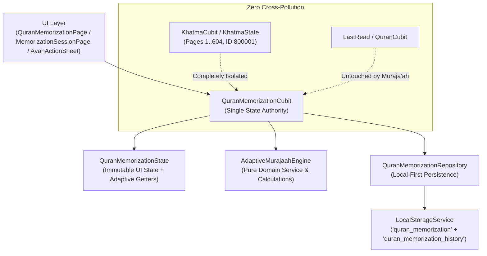
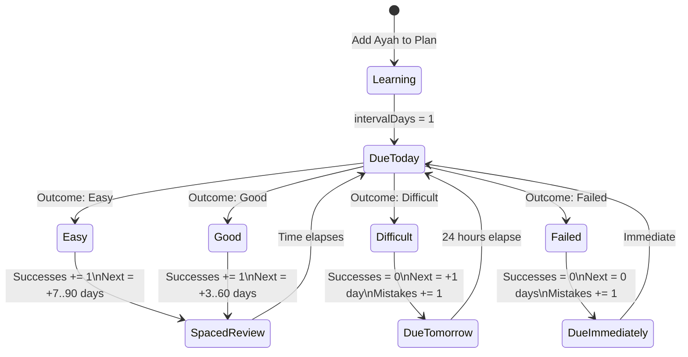

# 🕌 Mishkat Quran — Phase Q9: Advanced Adaptive Muraja'ah Engine (المراجعة التكيفية المتقدمة)

## 1. Executive Summary & Pedagogical Philosophy

Phase Q9 evolves the foundational rule-based revision queue of Phase Q8 into a sophisticated, offline-first, explainable **Adaptive Muraja'ah Engine (محرك المراجعة التكيفية المتقدمة)** for the Mishkat Flutter application. 

### 1.1 Islamic Pedagogical Principles & Philosophy
In traditional Quranic scholarship (*Ta'ahhud al-Quran* / تعاهد القرآن), memorization (*Hifz*) is not a static accomplishment but a living covenant that demands regular, structured review (*Muraja'ah*). The Prophet Muhammad ﷺ said:
> «تَعَاهَدُوا الْقُرْآنَ، فَوَالَّذِي نَفْسِي بِيَدِهِ لَهُوَ أَشَدُّ تَفَصِّيًا مِنَ الإِبِلِ فِي عُقُلِهَا» (صحيح البخاري)
> *"Commit yourselves to the Quran, for by Him in Whose Hand is my soul, it slips away faster than camels from their hobbles."* (Sahih al-Bukhari)

Modern spaced repetition algorithms (such as SM-2 or Leitner) were designed for discrete foreign-language vocabulary flashcards. Quranic retention exhibits unique dynamics:
- **Consecutive Context**: Ayahs belong to Surahs, rub's, and pages, requiring contextual coherence rather than isolated atomic facts.
- **Dignified, Non-Gamified Experience**: Strict rejection of streak counters, XP points, leaderboards, and anxiety-inducing mechanics. Sincerity (*Ikhlas*) is paramount.
- **Explainable & Deterministic**: The user must always understand *why* an Ayah is due or recommended for review (e.g., "مستحقة اليوم", "متأخرة 4 أيام", "تحتاج تثبيت").
- **Offline & Local-First**: Full calculation occurs locally on-device without cloud services, machine learning models, or external telemetry.

---

## 2. Architecture & Authority

The Adaptive Muraja'ah Engine follows strict Clean Architecture and feature isolation rules:



### 2.1 Single State Authority
- **`QuranMemorizationCubit`**: The sole manager of memorization and adaptive review state. No secondary cubits, service locators, or global variables are introduced.
- **`AdaptiveMurajaahEngine`**: A pure, stateless domain service (`lib/features/quran/presentation/services/adaptive_murajaah_engine.dart`) containing deterministic formulas for intervals, priority scores, schedule states, and queue sorting.
- **Decoupling from Khatma**: Khatma is page-centric ($1 \dots 604$ pages, notification ID `800001`), whereas Muraja'ah is Ayah-centric ($1 \dots 6236$ `globalAyah`, notification ID `800002`).
- **Preservation of `lastRead`**: Review sessions do not mutate the user's primary reading position in the Mushaf.

---

## 3. Domain Models & Specifications

All domain models reside in `lib/features/quran/data/models/murajaah_models.dart` and `memorization_item.dart`.

### 3.1 `ReviewOutcome`
Represents the 4-level subjective assessment following recall of an Ayah:

| Outcome | Enum Value | Arabic Label | Description | Next Review Effect |
| :--- | :--- | :--- | :--- | :--- |
| **Easy** | `easy` | **سهل** | Mastered, effortless recall with tajweed | Advanced jump on spacing ladder (7, 14, 30, 60, 90 days) |
| **Good** | `good` | **أعرفها ومحفوظة** | Solid recall, minor hesitation | Normal step on spacing ladder (3, 7, 14, 30, 60 days) |
| **Difficult** | `difficult` | **أحتاج مراجعة** | Stumbled, needed prompt, or doubt | Interval reset to 1 day; `mistakeCount` incremented |
| **Failed** | `failed` | **لم أتذكر** | Complete blank or severe error | Interval reset to 0 days (re-queue immediately); `mistakeCount` incremented |

### 3.2 `AdaptiveScheduleState`
Calculated evaluation of an Ayah's review urgency:
- `notDue`: `nextReviewAt` is in the future (> 0 hours remaining).
- `due`: Scheduled for review today ($\le 0$ hours remaining).
- `overdue`: Exceeded schedule by $\ge 24$ hours.
- `weak`: Item has high mistake density ($\ge 2$ mistakes) or is marked `needsRevision`.
- `urgent`: Severely overdue ($\ge 7$ days) or repeated failures ($\ge 4$ mistakes).

### 3.3 `AdaptiveMurajaahCategory`
Categorical filters for adaptive revision sessions:
1. `all` (**شاملة**): Prioritized combination of all active memorization items.
2. `dueToday` (**مستحقة اليوم**): Items whose `nextReviewAt` is on or before today.
3. `overdue` (**متأخرة**): Items overdue by at least 24 hours.
4. `weak` (**تحتاج تثبيت**): Items marked `needsRevision` or with multiple recorded mistakes.
5. `recentlyDifficult` (**صعبة مؤخراً**): Items evaluated as `difficult` or `failed` in their latest session.
6. `mistakeBased` (**أكثر الأخطاء**): Sorted primarily by highest lifetime `mistakeCount`.

### 3.4 `MemorizationReviewRecord`
Immutable historical log of an individual Ayah review event:
```dart
class MemorizationReviewRecord {
  final int globalAyah;        // 1..6236
  final ReviewOutcome outcome; // easy, good, difficult, failed
  final DateTime reviewedAt;   // Exact UTC/local timestamp
  final int intervalDaysAfter; // Scheduled interval produced by this review
  final int mistakeCountAfter; // Cumulative mistake count after this review
}
```

### 3.5 `MurajaahPriorityScore`
Explainable ranking score used to break ties and assemble review queues:
- **`score`**: Composite numeric value (higher = more urgent).
- **`dueDaysOverdue`**: Number of days past the scheduled due date.
- **`mistakeCount`**: Recorded mistakes for this Ayah.
- **`consecutiveSuccesses`**: Number of consecutive successful recalls.
- **`scheduleState`**: Current `AdaptiveScheduleState`.

---

## 4. Spaced Repetition Scheduling Algorithm

The scheduling logic is implemented in [`AdaptiveMurajaahEngine`](file:///Users/muhammedbashuaib/Documents/mishkat/mishkat_app/lib/features/quran/presentation/services/adaptive_murajaah_engine.dart).

### 4.1 Spacing Interval Ladders
Progression intervals (in days) are indexed by `consecutiveSuccesses`:

- **Good Ladder**: `[3, 7, 14, 30, 60]`
  - Review 0: 3 days
  - Review 1: 7 days
  - Review 2: 14 days
  - Review 3: 30 days
  - Review 4+: 60 days
- **Easy Ladder**: `[7, 14, 30, 60, 90]`
  - Review 0: 7 days
  - Review 1: 14 days
  - Review 2: 30 days
  - Review 3: 60 days
  - Review 4+: 90 days

### 4.2 State Transitions



### 4.3 Deterministic Priority Score Formula
The priority score $P$ is calculated as:
$$P = (\text{overdueDays} \times 10) + (\text{mistakeCount} \times 15) - (\text{consecutiveSuccesses} \times 2) + \text{StateBonus}$$

Where `StateBonus` is:
- `urgent`: $+100$
- `weak`: $+50$
- `overdue`: $+30$
- `due`: $+10$
- `notDue`: $0$

Tie-breaking is strictly deterministic: if two Ayahs produce identical priority scores, they are sorted by **`globalAyah` ascending** (preserving canonical Quranic sequence).

---

## 5. Local-First Persistence & Storage Architecture

### 5.1 Storage Keys
- `'quran_memorization'`: Stores JSON serialized `MemorizationItem` records and active `MemorizationPlan` instances.
- `'quran_memorization_history'`: Stores the list of `MemorizationReviewRecord` items.

### 5.2 History Capping Policy
To guarantee instant startup, minimal memory overhead, and zero performance degradation on mobile devices:
- Historical review logs are capped at **2,000 records** using a strict First-In, First-Out (FIFO) retention policy.
- Corrupted or invalid JSON items are discarded silently without throwing or crashing the application.

---

## 6. Notification Isolation

Mishkat enforces strict separation between notification domains to prevent ID collisions and notification overwrites:

| Notification Domain | Unique ID | Channel / Tag | Authority |
| :--- | :--- | :--- | :--- |
| **Khatma Reading Reminder** | `800001` | `khatma_reminder` | `KhatmaCubit` |
| **Muraja'ah Revision Reminder** | `800002` | `murajaah_reminder` | `QuranMemorizationCubit` |

---

## 7. Backward Compatibility with Phase Q8

The implementation is 100% backward-compatible:
1. **Existing Data Migration**: Existing `MemorizationItem` JSON maps lacking `nextReviewAt`, `intervalDays`, or `consecutiveSuccesses` automatically deserialize with safe defaults (`intervalDays: 1`, `consecutiveSuccesses: 0`).
2. **Q8 Legacy Queue Fallback**: When `generateRevisionQueue(limit, now)` is invoked without an explicit `AdaptiveMurajaahCategory`, it seamlessly executes the original Q8 4-Tier sorting algorithm, ensuring all previous tests and flows continue working with zero divergence.
3. **Button Text Compatibility**: The 4-level outcome row retains the exact text labels `"أعرفها ومحفوظة"` and `"أحتاج مراجعة"` for Good and Difficult evaluations respectively.

---

## 8. Verification & QA Matrix

- **Unit & Integration Tests**: 196 tests passing (`test/features/quran_adaptive_murajaah_test.dart` + existing suites).
- **Static Analysis**: `flutter analyze lib/ test/features/` reports **0 issues found**.
- **Asset Integrity**: 604 Madinah Mushaf SVG pages, `quran.json`, `mushaf-layout.json`, and `tafsir-muyassar.json` verified 100% intact and untouched.
