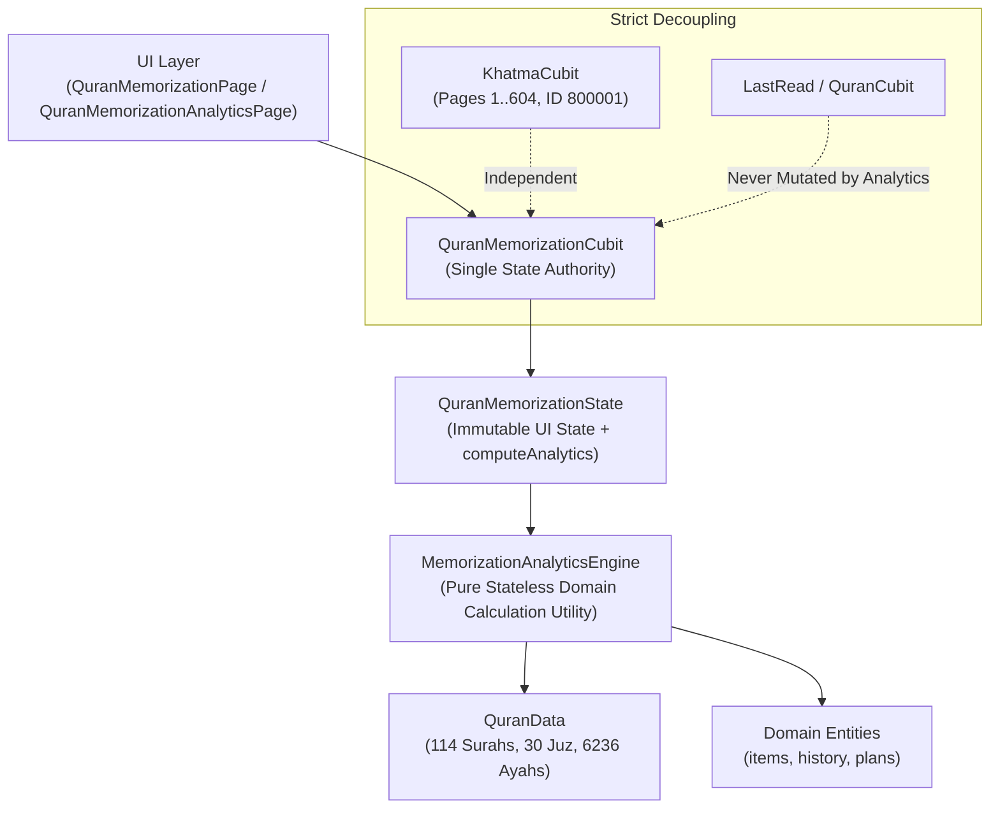

# 🕌 Mishkat Quran — Phase Q10: Advanced Memorization Analytics & Progress Intelligence (تحليلات الحفظ والمراجعة وذكاء التقدم)

## 1. Executive Summary & Pedagogical Purpose

Phase Q10 introduces **Advanced Memorization Analytics & Progress Intelligence (تحليلات الحفظ والمراجعة وذكاء التقدم)** into the Mishkat Flutter application. 

While Phase Q8 established the foundational memorization commitment data (plans, mastery states, sessions) and Phase Q9 established the adaptive Muraja'ah scheduling engine ("ماذا أراجع الآن؟"), Phase Q10 answers the higher-order reflective questions:
- *كيف يتطور حفظي مع مرور الوقت؟* (How is my retention evolving?)
- *أين مواضع قوتي، وأين أحتاج إلى مزيد من التثبيت؟* (Where am I solid, and where do I need consolidation?)
- *كيف تسير خطة الحفظ مقارنة بالمعدل المطلوب؟* (How is my pace tracking against my goal?)
- *ما حجم عبء المراجعة المتوقع في الأيام القادمة؟* (What is my expected Muraja'ah workload?)

### 1.1 Non-Negotiable Pedagogical & Dignity Principles
1. **Calm & Sincere**: Strict rejection of gamification (no XP, levels, coins, streaks, badges, or competitive leaderboards). Memorizing the Book of Allah is an act of worship (*Ibadah*) requiring reverence (*Khushu'*) and sincerity (*Ikhlas*).
2. **Explainable & Deterministic**: No opaque machine learning models or black-box heuristics. Every metric and recommendation is mathematically traceable.
3. **Small-Sample Honesty**: When data is insufficient ($< 5$ reviews), the system presents an honest state ("لا توجد بيانات مراجعة كافية بعد") instead of manufactured percentages like "100% نجاح" from a single Ayah.
4. **Action-Oriented**: The analytics surface never leads to dead ends. Every insight directly provides actionable triggers (e.g., [فتح في المصحف], [التفسير], [استماع], [مراجعة المواضع الضعيفة], [ابدأ مراجعة اليوم]).
5. **Local-First & Private**: 100% calculated on-device without telemetry, external APIs, cloud synchronization, or tracking SDKs.

---

## 2. Architecture & Authority



### 2.1 Single State Authority
- **No Secondary Cubits**: No `AnalyticsCubit` is introduced. `QuranMemorizationCubit` remains the sole authority.
- **Pure Derived Projection**: Analytics are computed on demand via `state.computeAnalytics(quranData)`.
- **Zero Storage Bloat**: No analytics results are persisted to disk. All metrics derive dynamically from `'quran_memorization'` (items, plans) and `'quran_memorization_history'` (retained review history).

---

## 3. Analytics Domain Models

All models reside in [`lib/features/quran/data/models/memorization_analytics_models.dart`](file:///Users/muhammedbashuaib/Documents/mishkat/mishkat_app/lib/features/quran/data/models/memorization_analytics_models.dart).

### 3.1 `OverallMemorizationAnalytics`
Evaluates canonical Quranic coverage:
- `totalAyahs`: Exactly 6,236 canonical Ayahs.
- `memorized`: Count of Ayahs marked `MemorizationStatus.memorized`.
- `learning`: Count of Ayahs marked `MemorizationStatus.learning`.
- `needsRevision`: Count of Ayahs marked `MemorizationStatus.needsRevision`.
- `notStarted`: Count of Ayahs not yet initiated ($6236 - (\text{memorized} + \text{learning} + \text{needsRevision})$).
- `coveragePercentage`: Fraction of Quran memorized ($0.0 \dots 1.0$).
- `dueToday`, `overdue`, `weak`: Counts calculated across active memorization items.

### 3.2 `ReviewRetentionAnalytics`
Evaluates review outcomes and temporal frequency:
- `totalReviews`: Total records evaluated from retained history (up to 2,000).
- `easyCount`, `goodCount`, `difficultCount`, `failedCount`: Outcome distribution.
- `successRate`: Ratio of $(\text{easy} + \text{good}) / \text{totalReviews}$, or `null` if total $< 5$.
- `difficultRate`, `failureRate`: Ratios of difficult and failed recalls.
- `reviewsToday`, `reviewsThisWeek`, `reviewsThisMonth`: Activity counts over calendar windows.
- `averageReviewsPerActiveDay`: Average review volume on active practice days.
- `hasSufficientData`: Boolean guard ($N \ge 5$).

### 3.3 `MurajaahTrendAnalytics`
Determines review velocity and trajectory:
- `direction`: `TrendDirection` (`increasing`, `stable`, `decreasing`, `insufficientData`).
- `reviewsLast7Days`, `reviewsPrevious7Days`: Comparative 7-day velocity.
- `reviewsLast30Days`, `reviewsPrevious30Days`: Comparative monthly volume.
- `description`: Explanatory Arabic summary string.

### 3.4 `PlanProgressAnalytics`
Pacing and remaining duration intelligence for an active plan:
- `plan`: Associated `MemorizationPlan`.
- `totalAyahs`, `memorizedCount`, `learningCount`, `needsRevisionCount`, `remainingCount`.
- `completionPercentage`: Progress fraction ($0.0 \dots 1.0$).
- `dailyTarget`: Configured quota.
- `estimatedDaysRemaining`: $\lceil \text{remaining} / \text{dailyTarget} \rceil$.
- `currentPace`: Realized rate ($\text{Ayahs}/\text{day}$) computed from elapsed days since plan creation.
- `paceStatus`: `PlanPaceStatus` (`onTrack`, `ahead`, `needsAttention`, `insufficientData`).
- `paceMessage`: Dignified, encouraging Arabic message.

### 3.5 `ReviewWorkloadForecast`
Anticipated Muraja'ah workload derived from items' `nextReviewAt` schedule:
- `dueTodayCount`: Items due on or before today.
- `dueTomorrowCount`: Items due tomorrow ($24 \dots 48\text{ hours}$).
- `dueNext7DaysCount`: Items scheduled in days $2 \dots 7$.
- `workloadLevel`: `WorkloadLevel` (`light` $\le 10$, `moderate` $11 \dots 30$, `heavy` $> 30$).

### 3.6 `WeakAyahInsight`
Individual Ayah flagged for retention attention:
- `globalAyah`, `surahNumber`, `surahName`, `ayahNumber`.
- `mistakeCount`, `scheduleState`, `lastOutcome`, `nextReviewAt`.
- `priorityScore`: Ranking score used for sorting.

### 3.7 `SurahMemorizationAnalytics` & `JuzMemorizationAnalytics`
Aggregated mastery metrics for all 114 Surahs and all 30 Juz divisions.

---

## 4. Mathematical Calculations & Algorithms

### 4.1 Plan Pace Calculation
Let $M$ be the count of memorized Ayahs in the plan, and $T_{\text{elapsed}}$ be the days elapsed since plan creation:
$$T_{\text{elapsed}} = \frac{\text{now} - \text{createdAt}}{24\text{ hours}}$$
- If $T_{\text{elapsed}} < 2.0$ or $M = 0$:
  $$\text{paceStatus} = \text{insufficientData}$$
- Else:
  $$\text{Pace} = \frac{M}{T_{\text{elapsed}}}$$
  - If $\text{Pace} \ge 1.1 \times \text{dailyTarget} \implies \text{ahead}$
  - Else if $\text{Pace} \ge 0.8 \times \text{dailyTarget} \implies \text{onTrack}$
  - Else $\implies \text{needsAttention}$

### 4.2 Trend Direction Algorithm
Let $R_1$ be reviews in the last 7 days, and $R_2$ be reviews in the previous 7 days (days $8 \dots 14$):
- If $(R_1 + R_2) < 5 \implies \text{insufficientData}$
- Let $\Delta = R_1 - R_2$:
  - If $\Delta \ge 3$ or $(R_2 > 0 \land \Delta / R_2 \ge 0.25 \land \Delta \ge 2) \implies \text{increasing}$
  - Else if $\Delta \le -3$ or $(R_2 > 0 \land \Delta / R_2 \le -0.25 \land \Delta \le -2) \implies \text{decreasing}$
  - Else $\implies \text{stable}$

### 4.3 Weak Ayahs Identification
An Ayah is considered a candidate if:
$$\text{status} = \text{needsRevision} \lor \text{mistakes} \ge 2 \lor \text{state} \in \{\text{weak}, \text{urgent}\} \lor \text{lastOutcome} \in \{\text{difficult}, \text{failed}\}$$
Candidates are ranked by `MurajaahPriorityScore.totalScore` descending, tie-breaking by `globalAyah` ascending.

---

## 5. Canonical Quranic Mappings

### 5.1 Surah Boundaries ($1 \dots 114$)
Verified through `QuranData.chapters`:
- Surah 1 (Al-Fatihah): 7 Ayahs ($1 \dots 7$).
- Surah 2 (Al-Baqarah): 286 Ayahs ($8 \dots 293$).
- ...
- Surah 114 (An-Nas): 6 Ayahs ($6231 \dots 6236$).

### 5.2 Juz Boundaries ($1 \dots 30$)
Verified continuous partitioning of all 6,236 Ayahs:
- Juz 1: Ayahs $1 \dots 148$ (148 Ayahs).
- Juz 2: Ayahs $149 \dots 259$ (111 Ayahs).
- ...
- Juz 30: Ayahs $5673 \dots 6236$ (564 Ayahs).
- **Sum of Ayahs across all 30 Juz**: Exactly **6,236** (zero gaps, zero overlaps).

---

## 6. User Interface Architecture

The analytics experience is presented in [`QuranMemorizationAnalyticsPage`](file:///Users/muhammedbashuaib/Documents/mishkat/mishkat_app/lib/features/quran/presentation/pages/quran_memorization_analytics_page.dart):

```
+-------------------------------------------------------+
|            تحليلات الحفظ والمراجعة                    |
+-------------------------------------------------------+
|  [✨] ذكاء التقدم القرآني                             |
|  نظرة هادئة على محفوظاتك وأولويات المراجعة            |
+-------------------------------------------------------+
|  تغطية الحفظ الكلية: 1,200 من 6,236 آية (19.2%)       |
|  [المحفوظ: 1200]  [قيد الحفظ: 80]  [يحتاج تثبيتاً: 15] |
+-------------------------------------------------------+
|  عبء المراجعة المتوقع: [خفيف وميسر]                   |
|  مستحقة اليوم: 18    غداً: 12    خلال 7 أيام: 45      |
|  [ ▶ ابدأ مراجعة اليوم (18 آية) ]                     |
+-------------------------------------------------------+
|  الخطة النشطة: حفظ سورة الملك                          |
|  23 من 30 آية (77%) • [على المسار]                    |
+-------------------------------------------------------+
|  أداء المراجعة والاحتفاظ                              |
|  اليوم: 12    هذا الأسبوع: 48    هذا الشهر: 160       |
|  معدل الاستذكار الناجح: 85%                           |
|  [↗] نشاط المراجعة في ازدياد مبارك                    |
+-------------------------------------------------------+
|  مواضع تحتاج تثبيتاً                   [مراجعة الكل]  |
|  - سورة البقرة: الآية 102 (3 أخطاء) [فتح] [تفسير] [▶] |
|  - سورة النساء: الآية 43 (2 أخطاء)  [فتح] [تفسير] [▶] |
+-------------------------------------------------------+
|  تغطية السور والأجزاء                                 |
|  [ السور (114) ]          [ الأجزاء (30) ]            |
|  - 1. سورة الفاتحة      7 / 7 آية             100%    |
|  - 2. سورة البقرة     120 / 286 آية            42%    |
+-------------------------------------------------------+
```

---

## 7. Performance & Memory Profile

- **Engine Execution**: $< 5\text{ ms}$ on representative data ($1,000$ active items $+ 500$ history records). Verified in automated benchmark test.
- **Memory Footprint**: All objects are ephemeral value objects collected immediately by GC.
- **Disk Footprint**: $0\text{ KB}$ (zero persistent overhead).

---

## 8. Verification & QA Matrix

- **Unit & Integration Tests**: 214 total passing tests across the entire codebase (`flutter test`).
- **Dedicated Q10 Suite**: 18 tests in [`test/features/quran_memorization_analytics_test.dart`](file:///Users/muhammedbashuaib/Documents/mishkat/mishkat_app/test/features/quran_memorization_analytics_test.dart).
- **Static Analysis**: `flutter analyze lib/ test/features/` reports **0 issues found**.
- **Asset Integrity**: 604/604 SVG pages and canonical JSON datasets verified 100% unmodified.
