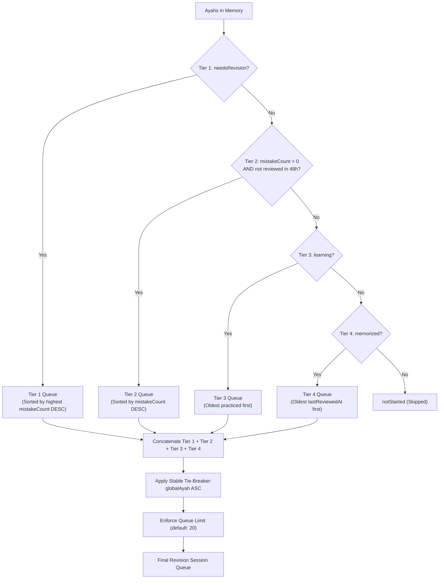

# 🕌 Mishkat Quran — Phase Q8: Quran Memorization & Revision Engine (Hifz & Muraja'ah)

## 1. Executive Summary

Phase Q8 introduces a dedicated, local-first Quran Memorization and Smart Revision subsystem into the Mishkat Flutter application. Built upon the solid architectural foundation of Phases Q1–Q7 (Mushaf SVG geometry, interactive Ayah layer, Al-Tafsir Al-Muyassar, audio synchronization, fuzzy search, and personal study continuity), the Memorization Engine provides Muslim users with a distraction-free, reliable companion for committing the Noble Quran to heart.

### Core Guarantees & Milestones
- **Ayah-Based Canonical Identity**: All mastery states, review history, and session queues anchor strictly on `globalAyah` ($1 \dots 6236$).
- **Strict Decoupling from Khatma**: Page-based Tilawah (`KhatmaCubit`) remains distinct from Ayah-based Hifz (`QuranMemorizationCubit`).
- **Zero Asset Mutation**: 604 Madinah Mushaf SVG pages, `quran.json`, `mushaf-layout.json`, and `tafsir-muyassar.json` remain untouched.
- **State Non-Interference**: Practice drills do not pollute `lastRead`. Touching or reviewing Ayahs in recall mode leaves reading position intact.
- **Deterministic 4-Tier Smart Revision Queue**: Intelligent prioritization ensuring difficult Ayahs and neglected memorization receive prompt reinforcement.
- **Distraction-Free Recall Mode**: Masked Quranic text enabling sincere recall with instant reveal verification.
- **100% Offline & Local-First**: Backed by `LocalStorageService` with corrupted record recovery.

---

## 2. Architecture & Domain Separation

### 2.1 The Two Distinct Quranic Commitments

| Dimension | Khatma (ختمة التلاوة) | Memorization & Revision (حفظ القرآن ومراجعته) |
| :--- | :--- | :--- |
| **Domain Purpose** | Reading completion (Tilawah) | Ayah retention and mastery (Hifz & Muraja'ah) |
| **Primary Unit** | Mushaf Page ($1 \dots 604$) | Canonical `globalAyah` ($1 \dots 6236$) |
| **Authoritative State** | `KhatmaCubit` / `KhatmaState` | `QuranMemorizationCubit` / `QuranMemorizationState` |
| **Storage Key** | `'khatma_plans'` | `'quran_memorization'` |
| **Session Nature** | Continuous page reading | Focused recall drill, self-assessment, and audio repetition |
| **Pacing Metric** | Pages per day | Ayahs per day |

---

## 3. Data Models & Specifications

All domain models reside in [`lib/features/quran/data/models/`](file:///Users/muhammedbashuaib/Documents/mishkat/mishkat_app/lib/features/quran/data/models/).

### 3.1 `MemorizationStatus`
Defines discrete mastery states for an individual Ayah:
```dart
enum MemorizationStatus {
  notStarted,     // لم تبدأ
  learning,       // قيد الحفظ
  memorized,      // تم الحفظ
  needsRevision;  // تحتاج مراجعة
}
```

### 3.2 `MemorizationItem`
Represents the personal mastery record for a specific canonical Ayah:
- `globalAyah` ($1 \dots 6236$): Clamped defensively.
- `status`: Current `MemorizationStatus`.
- `mistakeCount`: Non-negative counter incremented whenever "أحتاج مراجعة" is recorded.
- `lastReviewedAt`: Timestamp of the most recent practice or review evaluation.
- `updatedAt`: Timestamp of last mutation.

### 3.3 `MemorizationPlan`
Bounded memorization commitment:
- `id`: Unique identifier (e.g. `'plan_1728000000'`).
- `title`: User-friendly title (e.g. "حفظ سورة الكهف").
- `surah`: Optional canonical Surah number ($1 \dots 114$).
- `startGlobalAyah` & `endGlobalAyah`: Bounded range ($1 \dots 6236$, $start \le end$).
- `dailyTarget`: Configurable daily quota ($1 \dots 100$ Ayahs, default: 5).
- `isActive`: Boolean indicating active status.
- `createdAt` & `completedAt`: Timestamps tracking commitment lifecycle.
- `totalAyahs`: Derived getter (`endGlobalAyah - startGlobalAyah + 1`).
- `estimatedDays`: Derived getter (`(totalAyahs / dailyTarget).ceil()`).
- `isCompleted`: Derived getter (`completedAt != null`).

### 3.4 `MemorizationSession`
Active drill session checkpoint:
- `planId`: Optional associated plan ID (or null for generic revision sessions).
- `queue`: Deterministic list of target `globalAyah` indices.
- `currentIndex`: Zero-based pointer to the current Ayah in drill.
- `isTextHidden`: Recall mode toggle (true = masked, false = revealed).
- `sessionType`: `MemorizationSessionType.memorization` or `MemorizationSessionType.revision`.
- `completedCount`: Number of Ayahs assessed during this session.
- `progress`: Float ($0.0 \dots 1.0$).
- `isFinished`: Boolean indicating whether queue is exhausted.

---

## 4. Deterministic 4-Tier Smart Revision Algorithm

The revision engine selects Ayahs requiring reinforcement through an intelligent 4-tier heuristic:



### Tie-Breaking Rule
Within any tier, if priority metrics are equal, the stable tie-breaker is `globalAyah` ascending (reading order through the Mushaf).

---

## 5. User Journey & Screens

### 5.1 Quran Memorization Dashboard (`QuranMemorizationPage`)
- **Mastery Statistics Card**: Total memorized count, in-progress count, needs-revision count, and percentage of the entire Quran ($N / 6236$).
- **Active Plan Card**:
  - Surah name and Ayah range ($start \dots end$).
  - Progress bar and completion percentage.
  - "الورد اليومي" with daily target.
  - "متابعة الورد" button launching today's batch.
  - Menu options to pause, edit, or delete plan.
- **Smart Revision Card**:
  - Badge showing Ayahs ready for review according to the 4-tier algorithm.
  - "بدء جلسة المراجعة" action button.
- **Plan History**:
  - List of active and archived plans with progress bars and status badges.

### 5.2 Plan Setup (`MemorizationPlanPage`)
- Surah picker from `QuranData.chapters` ($1 \dots 114$).
- Interactive start and end Ayah dropdown selectors.
- Live calculation of total Ayahs and estimated completion days.
- Daily target slider and quick-select choice chips ($3, 5, 7, 10, 15$ Ayahs).
- Daily reminder notification toggle and time picker (`TimeOfDay`).

### 5.3 Interactive Recall Session (`MemorizationSessionPage`)
- **Distraction-Free Header**: Exit button with confirmation dialog, session title, progress bar, and counter (`الآية X من Y`).
- **Context Card**: Surah name, Ayah number, Juz number, Mushaf page, and mastery badge.
- **Recall Card**:
  - When hidden: Masked view inviting silent or audible recitation, with "إظهار نص الآية للتأكد" button.
  - When revealed: Uthmani script formatted in Amiri font with gold verse ornament.
- **Ayah Companion Tools**:
  - Single-Ayah audio recitation (`QuranCubit.playAyah(globalAyah, continuous: false)`).
  - Al-Tafsir Al-Muyassar bottom sheet (`TafsirKnowledgeSheet.show(...)`).
  - Open in Mushaf (`QuranReaderPage(initialGlobalAyah: globalAyah)`).
  - Retention bookmark toggle (`toggleAyahBookmark(globalAyah, label: 'آية تحتاج تثبيت')`).
- **Self-Assessment Actions**:
  - "أحتاج مراجعة": Increments `mistakeCount`, sets `needsRevision`, advances queue.
  - "أعرفها ومحفوظة": Sets `memorized`, advances queue, auto-completes plan if all Ayahs are confirmed.
- **Session Complete View**:
  - Celebration feedback with reviewed statistics and return button.

### 5.4 AyahActionSheet Integration
- Directly on the interactive Mushaf reader, long-pressing any Ayah displays a dedicated memorization status row showing current mastery state (`لم تبدأ`, `قيد الحفظ`, `تم الحفظ`, `تحتاج مراجعة`) with a 1-tap modal picker to update status immediately.

---

## 6. Daily Reminder Notification

- Scheduled via `LocalNotificationService` under ID `800001`.
- Configured during plan creation or update.
- Reschedules daily reminder at user's specified `TimeOfDay`.

---

## 7. Verification & Test Suite Summary

- **Total Test Suite**: 176 tests passing (100% success rate).
- **Q8-Specific Tests** in [`test/features/quran_memorization_test.dart`](file:///Users/muhammedbashuaib/Documents/mishkat/mishkat_app/test/features/quran_memorization_test.dart):
  - Domain models & JSON serialization.
  - Repository resilience against malformed & corrupted storage.
  - Plan CRUD and boundary clamping ($1 \le start \le end \le 6236$).
  - Daily target slice calculation & partial day handling.
  - Deterministic 4-tier revision algorithm & tie-breaking.
  - Recall session text hiding, reveal, and self-assessment.
  - Plan auto-completion upon full Ayah mastery.
  - Full 6,236 Ayah addressability.
  - Widget smoke tests for Dashboard, Plan creation, and Recall drill.
- **Static Analysis**: `flutter analyze lib/ test/features/` passes with **0 warnings and 0 errors**.
- **Visual Regression**: All 11 automated screenshots generated successfully.
