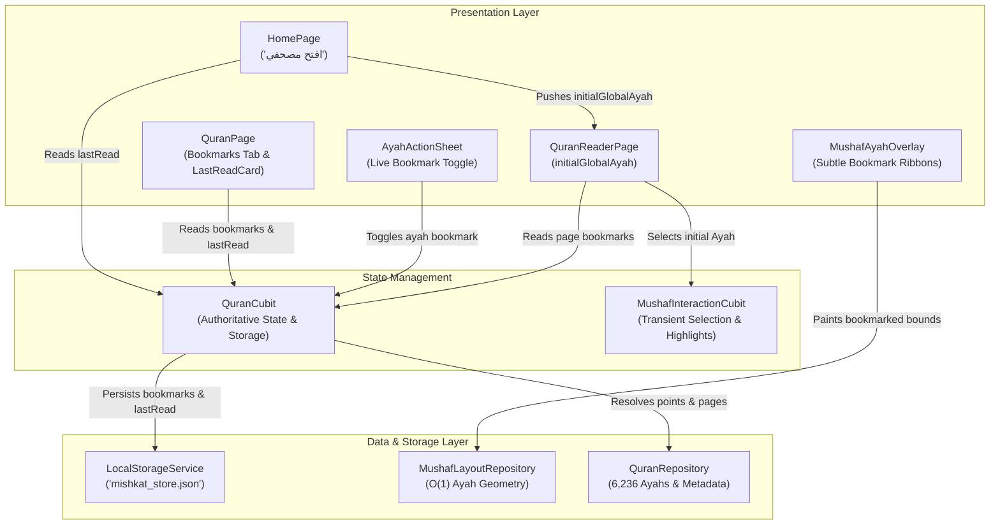

# 🕌 Mishkat Quran — Phase Q7 Architecture
# Personal Quran Study, Bookmarks & Reading Continuity Engine

---

## 1. Overview & Objectives

Phase Q7 elevates the Mishkat Quran subsystem from a pure viewing, reading, commentary, audio, and search experience into an intimate, personalized study companion. Prior to Q7, bookmarks were basic page-level markers that could not isolate individual Ayahs, suffered from overwrite conflicts when multiple bookmarks were placed on the same page, and lacked unified reading position continuity across the application.

### Key Capabilities Introduced in Q7:
1. **Deterministic Ayah-Level Bookmarking**: Every bookmark possesses explicit Ayah identity via canonical `globalAyah` ($1 \dots 6236$), Surah number ($1 \dots 114$), Ayah number within Surah, page number ($1 \dots 604$), creation timestamp, and optional user label/note.
2. **Coexistence Without Collision**: Multiple Ayahs on the exact same Mushaf page (e.g., Ayahs 1, 2, and 7 of Al-Fatiha on Page 1) can be bookmarked simultaneously without overwriting or interfering with one another.
3. **Unified Reading Continuity ("Last Read")**: The exact reading position (`lastRead`) is synchronized deterministically across the Home Page ("افتح مصحفي" / "متابعة المصحف"), the Quran Index ("متابعة القراءة"), and the Reader. Tapping "متابعة" lands the reader on the exact Mushaf page with the target Ayah highlighted and centered.
4. **Action Sheet Live Integration**: The Ayah Action Sheet bookmark button is fully activated, allowing immediate toggle with live visual feedback (`حفظ` / `إزالة`, bookmark icon toggle, and confirmation SnackBars), replacing the former `"قريباً"` placeholder.
5. **Rich Personal Study Index**: The Bookmarks tab in `QuranPage` features dual sorting ("الأحدث" / Most Recent vs "ترتيب المصحف" / Mushaf Order), bookmark count badges, Uthmani Arabic script snippets, direct quick actions (Mushaf, Tafsir, Audio), and Dismissible swipe-to-delete with SnackBar Undo.
6. **Subtle Mushaf Visual Indicators**: Bookmarked Ayahs feature an elegant, non-intrusive golden ribbon tab on the outer margin of their initial line on the active Mushaf page, visually distinct from both selection and audio playback highlights.

---

## 2. Architecture & State Management

The Personal Study architecture strictly adheres to Mishkat's Local-First, BLoC/Cubit architecture principles.



### State Separation Principles:
- **`QuranCubit`**: The single authoritative source of truth for persistent user state:
  - `bookmarks`: Immutable list of `QuranBookmark` objects.
  - `lastRead`: Persistent `QuranPoint` representing the user's reading position.
  - `currentPage`: Active Mushaf page.
- **`MushafInteractionCubit`**: Governs transient, short-lived UI touch interactions:
  - `selectedAyah`: Currently tapped Ayah bounds.
  - `playingAyah`: Currently reciting Ayah global index (synchronized from audio).
  - Cleanly decoupled from `QuranCubit` to prevent expensive page rebuilds during scrolling or audio ticks.
- **State Independence**:
  `selectedAyah`, `playingAyah`, and `bookmarkedAyahs` are completely independent. An Ayah can be simultaneously bookmarked, selected by touch, and actively playing audio without state collision or visual ambiguity.

---

## 3. Data Model & Persistence Schema

### 3.1 `QuranBookmark` Model
```dart
class QuranBookmark {
  const QuranBookmark({
    required this.page,
    required this.point,
    required this.createdAt,
    this.label,
  });

  final int page;
  final QuranPoint point;
  final DateTime createdAt;
  final String? label;

  Map<String, dynamic> toJson() => {
    'page': page,
    'point': point.toJson(),
    'createdAt': createdAt.toIso8601String(),
    if (label != null) 'label': label,
  };
}
```

### 3.2 `QuranPoint` Structure
```dart
class QuranPoint {
  const QuranPoint({
    required this.surah,
    required this.ayah,
    required this.global,
  });

  final int surah;
  final int ayah;
  final int global;

  Map<String, dynamic> toJson() => {
    's': surah,
    'a': ayah,
    'g': global,
  };
}
```

### 3.3 Storage Schema (`mishkat_store.json`)
The bookmarks and reading position are stored locally under the `'quran'` key:
```json
{
  "quran": {
    "currentPage": 42,
    "lastRead": {
      "s": 2,
      "a": 255,
      "g": 262
    },
    "bookmarks": [
      {
        "page": 42,
        "point": {
          "s": 2,
          "a": 255,
          "g": 262
        },
        "createdAt": "2026-10-04T12:00:00.000Z",
        "label": "آية الكرسي"
      }
    ]
  }
}
```

---

## 4. Resilient Corrupted Data Recovery

Local storage is subject to potential corruption, schema evolution, or invalid values. Q7 introduces robust fault tolerance in `QuranCubit.load()`:
1. **Range Validation**: Every bookmark and `lastRead` point is validated:
   $$1 \le \text{globalAyah} \le 6236 \quad \text{and} \quad 1 \le \text{surah} \le 114$$
2. **Structural Safeguards**: Non-map entries, null values, and missing fields are caught inside safe `try/catch` handlers and discarded without failing the overall Quran dataset load.
3. **Deduplication**: If storage contains redundant entries for the same `globalAyah`, only the first entry is retained.
4. **Zero Crashing**: Even if the entire `'bookmarks'` or `'lastRead'` block is malformed, `QuranCubit` logs the anomaly and defaults gracefully to an empty bookmark list or the top of the current page.

---

## 5. Visual Design & Mushaf Overlay Integration

### 5.1 Subtle Bookmark Ribbon Indicator
In `MushafAyahHighlightPainter`:
- When an Ayah on the current Mushaf page is bookmarked, a subtle 3.5px wide rounded vertical accent bar is drawn on the right margin (RTL start) of the Ayah's initial line.
- **Color Aesthetics**:
  - Light mode: Deep rich gold (`Color(0xFFC59B27)`).
  - Dark mode: Warm bright gold (`Color(0xFFFFD54F)`).
- **Non-Obtrusive**: The indicator resides along the right boundary of the Ayah's geometry, avoiding any interference with Quranic text, diacritics (Tashkeel), or ayah stop symbols.
- **Layer Coexistence**:
  - If the Ayah is also selected, the soft emerald selection fill renders behind the golden bookmark ribbon.
  - If the Ayah is playing audio, the golden amber playback fill renders behind the ribbon.

---

## 6. Personal Study User Experience

### 6.1 Quran Index Bookmarks Tab (`QuranPage`)
- **Header & Sorting**:
  - Displays total count badge: `${bookmarks.length} علامة`.
  - Dual sorting via `SegmentedButton`:
    - **الأحدث (Most Recent)**: Displays newly created bookmarks at the top.
    - **ترتيب المصحف (Mushaf Order)**: Sorts monotonically by `globalAyah` ascending (matching page order from 1 to 604).
- **Bookmark Card**:
  - Surah name, page number, Ayah number within Surah.
  - Custom note/label badge when present.
  - Uthmani Quranic text snippet rendered in authentic Amiri calligraphy.
  - Quick action buttons:
    - **المصحف**: Deep links to the exact page and centers the Ayah.
    - **التفسير**: Opens Al-Tafsir Al-Muyassar directly via `TafsirKnowledgeSheet`.
    - **استماع**: Triggers recitation of the bookmarked Ayah.
- **Swipe-to-Delete with Undo**:
  - Swiping a bookmark triggers `Dismissible` with a red trash background.
  - Displays an immediate SnackBar with a `تراجع` (Undo) action that restores the exact bookmark with its custom label.
- **Empty State**:
  - Welcoming Islamic design with bookmark icon, helpful guidance, and instructions on how to bookmark Ayahs from the reader.

---

## 7. Verification & Health Summary

| Test Category | Suite / File | Status |
| :--- | :--- | :--- |
| **Bookmark CRUD & Persistence** | `test/features/quran_bookmarks_test.dart` | ✅ PASS |
| **Ayah-Level Coexistence** | `test/features/quran_bookmarks_test.dart` | ✅ PASS |
| **Corrupted Data & Range Recovery** | `test/features/quran_bookmarks_test.dart` | ✅ PASS |
| **Reading Continuity ("Last Read")** | `test/features/quran_bookmarks_test.dart` | ✅ PASS |
| **State Decoupling & Isolation** | `test/features/quran_bookmarks_test.dart` | ✅ PASS |
| **Full 6,236 Ayah Completeness** | `test/features/quran_bookmarks_test.dart` | ✅ PASS |
| **Search & Deep Navigation** | `test/features/quran_search_test.dart` | ✅ PASS |
| **Mushaf Geometry & Interaction** | `test/features/mushaf_interaction_test.dart` | ✅ PASS |
| **Audio Sync & Mini Player** | `test/features/quran_audio_sync_test.dart` | ✅ PASS |
| **Tafsir Engine & Action Sheet** | `test/features/tafsir_test.dart` | ✅ PASS |
| **Mushaf SVG Artwork (604 pages)** | `test/features/quran_reader_foundation_test.dart` | ✅ PASS |
| **Static Code Analysis** | `flutter analyze lib/ test/features/` | ✅ 0 issues |
| **Full Test Suite Execution** | `flutter test` | ✅ 158/158 PASS |
